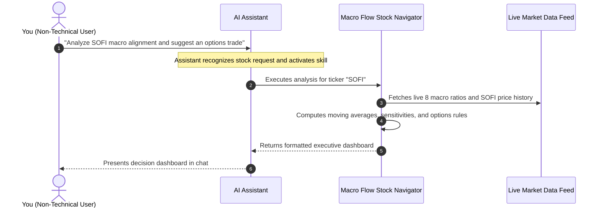

# Macro Flow Stock Navigator

**Version:** 1.0.0 | **Supported Harnesses:** Agent Harnesses, AI Assistants | **License:** Apache 2.0 | **Tests:** 8 Passed | **Data:** Real-Time Public Market Data

**Macro Flow Stock Navigator** is an enterprise-grade agent skill and algorithmic decision engine designed for AI agent harnesses, assistants, and execution environments complying with the `SKILL.md` and Skill Plug-in specifications.

It bridges high-level cross-asset macroeconomic regimes with single-stock positioning and quantitative derivative strategies. By calculating 8 real-time macro ratio indicators from live market data, determining stock archetypes, and running a weighted alignment matrix, the skill produces an executive trading decision dashboard with clear status signals (`STRONG BUY`, `ACCUMULATE`, `NEUTRAL / RANGING`, `PROTECT / SELL`), an actionable **Strategic Options Playbook** (Cash-Secured Puts, Covered Calls, Debit Spreads), and an **Interactive Canvas UI Dashboard** with dark/light themes and real-time interactive charts.


---

## Table of Contents
1. [Key Features and Capabilities](#key-features-and-capabilities)
2. [Interactive Canvas UI Dashboard](#interactive-canvas-ui-dashboard)
3. [Non-Technical User Guide](#non-technical-user-guide)
4. [Sample Prompts Library](#sample-prompts-library)
5. [How to Read the Output (Executive Decoder)](#how-to-read-the-output-executive-decoder)
6. [Frequently Asked Questions (FAQ)](#frequently-asked-questions-faq)
7. [The 8 Macro Ratio Indicators](#the-8-macro-ratio-indicators)
8. [Stock Archetype Taxonomy](#stock-archetype-taxonomy)
9. [Strategic Options Playbook Matrix](#strategic-options-playbook-matrix)
10. [Running the Python Code (Technical Guide)](#running-the-python-code-technical-guide)
11. [Automated Testing and Verification](#automated-testing-and-verification)
12. [Repository Structure](#repository-structure)
13. [License](#license)

---

## Key Features and Capabilities

- **Real-Time Cross-Asset Macro Regime Detection:** Synthesizes 8 distinct market ratios spanning breadth, gold, tech momentum, small caps, market valuation, high beta, cyclical consumption, and volatility using live market data.
- **Stock Archetype Sensitivity Engine:** Dynamically classifies equities into 5 core archetypes (Mega-Cap Tech, High-Beta Speculative Growth, Cyclicals, Defensives, Financials) and applies tailored mathematical sensitivity weights.
- **Concise Executive Dashboard:** Delivers clean Markdown cards with summary status tables, status text indicators, force decomposition (tailwinds vs. headwinds), and options execution tables.
- **Interactive Canvas UI Dashboard:** Generates a standalone, responsive HTML/JS/CSS dashboard rendered in Canvas iframe with light/dark theme switching, real-time Chart.js visual price trends, macro factor radar charts, and an options payoff simulator.
- **Quantitative Options Execution:** Formulates exact option parameters including Delta targeting (e.g. `0.20-0.28 Delta`), optimal strike placement (e.g. `% OTM below 50-MA support`), target DTE (`30-45 DTE`), and risk-defined stop-loss criteria.
- **Live Data Engine:** Retrieves up-to-date market feeds directly for accurate real-time analysis.

---

## Interactive Canvas UI Dashboard

The skill includes full support for rich, interactive **Canvas UI Dashboards** rendered directly inside Canvas iframe webviews in supported agent harnesses.

### Canvas Dashboard Features:
1. **Light / Dark Mode Toggle:**
   - Smooth instant switching between dark theme (deep slate/charcoal) and light theme (clean high-contrast gray/white).
   - Theme persistence via `localStorage` and dynamic real-time color adaptation for all chart canvases, gridlines, typography, and card containers.
2. **Interactive Tab Navigation:**
   - **Executive Overview:** High-level KPIs, Macro Alignment Score meter (-100 to +100), conviction metrics, 50-MA/200-MA technical health, and tailwinds vs. headwinds decomposition.
   - **8 Macro Indicators Grid:** Interactive card matrix for all 8 cross-asset ratios with real-time percentile bars and one-click filtering (`All`, `Bullish Signals`, `Bearish Signals`, `Neutral Signals`).
   - **Trend & Factor Charts:** Interactive Chart.js price trend visualization comparing the target stock's daily close against its 50-day and 200-day moving averages, alongside a 90-day multi-factor percentile radar chart.
   - **Strategic Options Playbook & Simulator:** Full options parameters table combined with an **Interactive Strategy Payoff Simulator** where users can drag a stock price slider to visualize profit/loss zones and breakeven boundaries at expiration.

### How to Generate the Canvas UI Dashboard:
```bash
# Generate interactive Canvas UI dashboard for any ticker (e.g. GOOG, NVDA, SOFI)
python3 scripts/run_analysis.py --ticker GOOG --format html --output reports/dashboard_GOOG.html
```

Pre-rendered sample HTML dashboards are available in the [`sample_data/`](sample_data/) directory:
- [`sample_data/sample_dashboard_GOOG.html`](sample_data/sample_dashboard_GOOG.html) (Mega-Cap Tech)
- [`sample_data/sample_dashboard_NVDA.html`](sample_data/sample_dashboard_NVDA.html) (Mega-Cap Tech / Momentum)
- [`sample_data/sample_dashboard_SOFI.html`](sample_data/sample_dashboard_SOFI.html) (High-Beta Speculative Growth)

---

## Non-Technical User Guide

### What Is This Skill?
When investing or trading, evaluating an individual company in isolation is only half the battle. Broad economic forces—interest rates, market breadth, inflation fears, and risk appetite—often drive stock prices more than individual company news.

The **Macro Flow Stock Navigator** is an automated analytical assistant that answers three practical questions for any US stock using real-time market data:
1. **Is the broader market environment helping or hurting this specific stock right now?**
2. **What overall action is recommended based on macro currents?**
3. **What lower-risk options trade can be used to generate income or protect capital?**

### How to Use This Skill (No Coding Required)
You do not need to install software, write code, or use a terminal. When this skill is active in your AI chat interface, you simply converse with the AI in plain English.



### 3 Simple Steps:
1. **Open your AI chat window** where the skill is enabled.
2. **Type your request in plain English** with any US stock ticker symbol (e.g., `GOOG`, `SOFI`, `NVDA`, `AAPL`, `TSLA`, `CAT`, `JNJ`, `JPM`).
3. **Review your decision dashboard**, which clearly presents the stock signal, macro tailwinds, headwinds, and recommended option trade parameters.

### Practical Examples for Common Scenarios

#### Example A: Checking Stock Macro Health
- **User Prompt:** *"Can you check the macro environment for GOOG? Is it a good time to buy or should I wait?"*
- **What the AI does:** The AI analyzes GOOG as a Mega-Cap Tech company, measures live tech momentum (`NDX/SPX`), broad market breadth (`RSP/SPY`), and fear levels (`VIX/SPX`), and delivers a summary showing whether GOOG has positive tailwinds or negative headwinds.

#### Example B: Generating Income with Options (Cash-Secured Puts)
- **User Prompt:** *"I want to generate income on SOFI. What strike price and expiration date make sense based on current market conditions?"*
- **What the AI does:** The AI calculates SOFI's volatility and macro score from real-time data, recommending a Cash-Secured Put strike safely below recent support levels with an expiration window (30-45 days) that maximizes time decay while maintaining an estimated 75-80% statistical probability of profit.

#### Example C: Protecting Existing Stock Holdings (Covered Calls or Collars)
- **User Prompt:** *"I own 100 shares of AAPL. The market feels choppy. Should I sell covered calls, and at what price target?"*
- **What the AI does:** The AI evaluates current volatility and resistance levels, recommending an optimal covered call strike positioned above key technical resistance to generate yield without unnecessarily risking early stock assignment.

#### Example D: Comparing Two Stocks
- **User Prompt:** *"Compare CAT and NVDA. Which stock is benefiting more from today's macro trends?"*
- **What the AI does:** The AI runs parallel assessments, contrasting cyclical industrial sensitivity against semiconductor tech momentum to clarify which asset has stronger macro support.

---

## Sample Prompts Library

Copy and paste any of the sample prompts below directly into your AI assistant:

### 1. Basic Stock and Macro Health Checks
| Goal | Copy-Paste Sample Prompt |
| :--- | :--- |
| **Single Stock Analysis** | *"Analyze `GOOG` using the Macro Flow Stock Navigator. Is the macro environment bullish or bearish for it today?"* |
| **Speculative Growth Check** | *"Is the current market flow favorable for `SOFI`? Check small-cap breadth and speculative appetite."* |
| **Mega-Cap Tech Leadership** | *"Run a macro flow check on `NVDA`. Is tech momentum still leading the market, or is money rotating into defensives?"* |
| **Plain-English Request** | *"Evaluate `AAPL` with the Macro Flow Stock Navigator and explain the results concisely in business terms."* |

### 2. Options Strategy and Income Generation
| Goal | Copy-Paste Sample Prompt |
| :--- | :--- |
| **Selling Cash-Secured Puts** | *"I want to generate income by selling cash-secured puts on `SOFI` or `PLTR`. Use the Macro Flow Stock Navigator to check if it's safe and tell me the optimal strike price and delta."* |
| **Selling Covered Calls** | *"I own 100 shares of `GOOG`. Run a macro alignment check and recommend a 30-day covered call strike above key resistance."* |
| **Low-Risk Growth Spreads** | *"What options strategy does the Macro Flow Navigator recommend for `NVDA` right now based on its implied volatility and macro score?"* |
| **Yield vs. Capital Safety** | *"Compare the risk-reward of selling puts on `TSLA` (high volatility) versus `CAT` (industrial cyclical) under current macro flow conditions."* |

### 3. Portfolio Protection and Risk Management
| Goal | Copy-Paste Sample Prompt |
| :--- | :--- |
| **Hedging Tech Holdings** | *"The market feels volatile. Run a macro flow check on my tech holdings (`MSFT`, `AAPL`) and suggest downside protection or bear spreads if needed."* |
| **Flight to Safety Check** | *"Is capital rotating into Gold (`GLD`) or Low Volatility (`SPLV`)? Run the Macro Flow Navigator for `JNJ` to see if defensive value is winning."* |
| **Pre-FOMC Risk Review** | *"Check the `VIX / SPX` and `IWM / SPY` ratios for `SOFI` ahead of the upcoming Fed interest rate announcement."* |

### 4. Multi-Stock and Sector Comparison
| Goal | Copy-Paste Sample Prompt |
| :--- | :--- |
| **Tech vs. Industrial** | *"Compare `GOOG` (Mega-Cap Tech) and `CAT` (Industrial Cyclical) with the Macro Flow Stock Navigator. Which one has stronger macro tailwinds this month?"* |
| **Growth vs. Defensive** | *"Should I allocate capital to `SOFI` (Speculative Growth) or `JNJ` (Defensive Value)? Run a cross-asset alignment comparison on both."* |

### 5. Programmatic JSON Output
| Goal | Copy-Paste Sample Prompt |
| :--- | :--- |
| **JSON Export for Downstream Tools** | *"Analyze `SOFI` using the Macro Flow Stock Navigator and output the structured JSON payload."* |

---

## How to Read the Output (Executive Decoder)

When the skill completes its analysis, it renders a concise 4-part dashboard:

### 1. Executive Summary Table
```markdown
# Macro Flow Stock Navigator: GOOG

| Metric | Value | Metric | Value |
| :--- | :--- | :--- | :--- |
| **Current Price** | $333.80 (+0.45%) | **Stock Archetype** | Mega-Cap Tech / High Quality Growth |
| **Recommended Action** | ACCUMULATE | **Macro Alignment** | [██████░░░░] +25.0/100 (Bullish) |
| **Macro Regime** | Consolidation / Sector Rotation | **Timestamp** | 2026-09-04 15:20 UTC |
```
- **`STRONG BUY / ACCUMULATE`**: Macro currents are strongly aligned in the stock's favor. Favorable for long positioning or selling cash-secured puts.
- **`NEUTRAL (RANGING)`**: Mixed macro signals. Stock is oscillating in a channel; optimal for theta harvesting (Covered Calls or Iron Condors).
- **`REDUCE / PROTECT / SELL`**: Hostile macro headwinds (rising fear, capital flight). Avoid unhedged long exposure.

### 2. Macro Cross-Asset Indicators (8 Ratios)
- **`RSP / SPY` (Market Breadth):** Equal-weight vs. cap-weight S&P 500 (broad participation vs. narrow concentration).
- **`GLD / SPX` (Risk Sentiment):** Gold vs. S&P 500 (falling = risk-on pro-growth; rising = safe-haven flight).
- **`NDX / SPX` (Tech Momentum):** Nasdaq 100 vs. S&P 500 (tech leadership and multiple expansion).
- **`IWM / SPY` (Small-Cap Vitality):** Russell 2000 vs. S&P 500 (economic liquidity and credit sentiment).
- **`SPX / GDP` (Valuation):** S&P to GDP Buffett indicator (valuation multiple expansion vs. mean reversion).
- **`SPHB / SPLV` (Speculative Appetite):** High Beta vs. Low Volatility (risk tolerance vs. defensiveness).
- **`XLY / XLP` (Cyclical Health):** Discretionary vs. Staples (consumer confidence vs. belt-tightening).
- **`VIX / SPX` (Normalized Fear):** Volatility index normalized against broad index trend.

### 3. Macro Drivers and Sensitivity Analysis
- **Tailwinds:** Macro forces actively supporting upward momentum.
- **Headwinds:** Macro resistances that could compress valuations or trigger pullbacks.

### 4. Strategic Options Playbook
- **Strategy Selection:** Formulated based on historical volatility and macro alignment.
- **Target Delta:** Calibrated for statistical probability of profit (e.g., `0.20-0.28 Delta` = ~75-80% probability).
- **Strike Selection:** Positioned safely below key 50-day moving average support floors.
- **Target DTE:** 30 to 45 days to optimize theta time decay.
- **Risk Management:** Clear, defined-risk exit rules for profit targets and stop losses.

---

## Frequently Asked Questions (FAQ)

### Q1: Do I need any API keys or paid financial subscriptions?
**No.** The skill automatically fetches free public market data in real time.

### Q2: What stock ticker symbols work?
**Any publicly traded US equity or ETF.** Examples: `GOOG`, `AAPL`, `MSFT`, `NVDA`, `SOFI`, `PLTR`, `TSLA`, `CAT`, `JNJ`, `JPM`, `SPY`, `QQQ`, `IWM`.

### Q3: Does this skill store any personal or financial information?
**No.** The skill processes only the public ticker symbol requested. It stores no private user data or sensitive financial account information.

---

## The 8 Macro Ratio Indicators

| Indicator | Ratio Tickers | What It Measures | Favorable Condition |
| :--- | :--- | :--- | :--- |
| **Market Breadth** | `RSP / SPY` | Equal-weight vs. cap-weight S&P 500 | Rising = Broad market participation; Falling = Narrow mega-cap dominance |
| **Macro Risk Sentiment** | `GLD / SPX` | Gold vs. S&P 500 Index | Falling = Pro-growth Risk-On; Rising = Flight-to-safety / stagflation hedge |
| **Tech Momentum** | `NDX / SPX` | Nasdaq 100 vs. S&P 500 | Rising = Tech leadership & growth multiple expansion; Falling = Value rotation |
| **Small Cap Strength** | `IWM / SPY` | Russell 2000 vs. S&P 500 | Rising = Economic expansion & liquidity; Falling = Tightening / large-cap flight |
| **Macro Valuation** | `SPX / GDP` | Buffett Indicator (Market Cap to GDP) | Normalized = Healthy equity valuations (<140%) |
| **Speculative Appetite** | `SPHB / SPLV` | High Beta vs. Low Volatility S&P | Rising = Speculative risk-seeking; Falling = Capital preservation |
| **Cyclical Growth** | `XLY / XLP` | Consumer Discretionary vs. Staples | Rising = Strong consumer spending confidence; Falling = Defensive belt-tightening |
| **Fear Normalization** | `VIX / SPX` | Normalized CBOE Volatility Index | Falling = Volatility compression; Spiking = Capitulation or stress |

*For detailed formulas and historical regimes, see [`references/macro_indicators_guide.md`](references/macro_indicators_guide.md).*

---

## Stock Archetype Taxonomy

```text
                          ┌──────────────────────────┐
                          │   Target Stock Ticker    │
                          └─────────────┬────────────┘
                                        │
             ┌──────────────────────────┼──────────────────────────┐
             ▼                          ▼                          ▼
   ┌───────────────────┐      ┌───────────────────┐      ┌───────────────────┐
   │   MEGA-CAP TECH   │      │ HIGH-BETA GROWTH  │      │CYCLICAL/INDUSTRIAL│
   │  GOOG, MSFT, AAPL │      │ SOFI, PLTR, AFRM  │      │  CAT, DE, GM, URI │
   │ Sensitive to NDX, │      │ Sensitive to IWM, │      │ Sensitive to XLY, │
   │ RSP concentration │      │ SPHB, GLD, & VIX  │      │ RSP, & IWM breadth│
   └───────────────────┘      └───────────────────┘      └───────────────────┘
             │                                                     │
             └──────────────────────────┬──────────────────────────┘
                                        │
             ┌──────────────────────────┴──────────────────────────┐
             ▼                                                     ▼
   ┌───────────────────┐                                 ┌───────────────────┐
   │  DEFENSIVE VALUE  │                                 │FINANCIALS/BANKING │
   │  JNJ, PG, KO, WMT │                                 │ JPM, BAC, GS, MS  │
   │ Sensitive to SPLV,│                                 │ Sensitive to IWM, │
   │ GLD, low beta     │                                 │ RSP, credit yield │
   └───────────────────┘                                 └───────────────────┘
```

*For complete archetype sensitivity weights, see [`references/archetype_taxonomy.md`](references/archetype_taxonomy.md).*

---

## Strategic Options Playbook Matrix

| Macro Alignment | Realized Volatility | Technical Structure | Recommended Options Play |
| :--- | :--- | :--- | :--- |
| **Bullish (> +20)** | **High (IV > 35%)** | Above 50-MA or Support | **Cash-Secured Puts (0.20-0.28 Delta, 30-45 DTE)** |
| **Bullish (> +20)** | **Low (IV < 30%)** | Clean Breakout | **Bull Call Debit Spread (ATM/OTM, 45-75 DTE)** |
| **Neutral (-15 to +20)** | **High (IV > 35%)** | Range-Bound Channel | **Iron Condor / Short Put Spreads** |
| **Neutral (-15 to +20)** | **Moderate (IV 20-35%)** | Mild Uptrend | **Covered Calls (0.25-0.35 Delta, 21-35 DTE)** |
| **Bearish (< -20)** | **Elevated** | Below 50-MA Breakdown | **Bear Put Spread / Downside Collar** |

*For complete strike selection rules, see [`references/options_playbook_matrix.md`](references/options_playbook_matrix.md).*

---

## Running the Python Code (Technical Guide)

### 1. Installation and Environment Setup
```bash
# Navigate to the skill directory
cd macro-flow-stock-navigator-skill

# Create and activate virtual environment
python3 -m venv .venv
source .venv/bin/activate

# Install dependencies
pip install -r requirements.txt
```

### 2. Command-Line Interface (CLI) Usage
The main runner is located at [`scripts/run_analysis.py`](scripts/run_analysis.py):

```bash
# Analyze a Mega-Cap Tech stock (e.g. GOOG)
python3 scripts/run_analysis.py --ticker GOOG

# Analyze a High-Beta Speculative stock (e.g. SOFI)
python3 scripts/run_analysis.py --ticker SOFI

# Generate interactive Canvas UI HTML Dashboard
python3 scripts/run_analysis.py --ticker GOOG --format html --output reports/dashboard_GOOG.html

# Generate structured JSON output for API/agent pipelines
python3 scripts/run_analysis.py --ticker SOFI --format json

# Save dashboard report to a markdown file
python3 scripts/run_analysis.py --ticker GOOG --output reports/GOOG_report.md
```

### CLI Parameter Options:
- `--ticker`, `-t`: Target ticker symbol (default: `GOOG`).
- `--lookback`, `-l`: Lookback window in trading days (default: `90`).
- `--format`, `-f`: Output format: `markdown` (default dashboard), `html` (interactive Canvas UI dashboard), `json`, or `summary`.
- `--output`, `-o`: File path to save output.
- `--gdp`: Nominal US GDP in Trillions for the Buffett indicator calculation (default: `29.5`).

---

## Automated Testing and Verification

The codebase includes full unit and integration test coverage across all mathematical models, data fetchers, and rendering engines.

```bash
# Run the complete test suite
python3 scripts/test_skill.py

# Or run pytest directly
pytest -v tests/
```

---

## Repository Structure

```text
macro-flow-stock-navigator-skill/
├── LICENSE                           # Apache License 2.0
├── README.md                         # Comprehensive documentation and non-technical guide
├── SKILL.md                          # Primary Agent Skill specification
├── plugin.json                       # Skill Plug-in manifest
├── pyproject.toml                    # Package metadata and build configuration
├── requirements.txt                  # Python dependencies
├── docs/
│   └── images/
│       └── macro_flow_workflow.jpg   # Architecture & workflow diagram
├── references/
│   ├── archetype_taxonomy.md         # Stock archetype classification & sensitivity rules
│   ├── macro_indicators_guide.md     # Deep dive into the 8 macro ratio indicators
│   └── options_playbook_matrix.md    # Options strategy selection & execution matrix
├── sample_data/
│   ├── sample_dashboard_GOOG.html    # Interactive Canvas UI Dashboard for GOOG
│   ├── sample_dashboard_NVDA.html    # Interactive Canvas UI Dashboard for NVDA
│   ├── sample_dashboard_SOFI.html    # Interactive Canvas UI Dashboard for SOFI
│   ├── sample_output_GOOG.md         # Example rendered real-time Markdown report for GOOG
│   ├── sample_output_NVDA.md         # Example rendered real-time Markdown report for NVDA
│   └── sample_output_SOFI.md         # Example rendered real-time Markdown report for SOFI
├── scripts/
│   ├── run_analysis.py               # Main CLI tool for market analysis & dashboard rendering
│   └── test_skill.py                 # Automated verification & test runner
├── src/
│   ├── __init__.py
│   ├── config.py                     # Stock archetypes, indicator weights, and options rules
│   ├── data_fetcher.py               # Real-time live market data fetcher
│   ├── decision_engine.py            # Alignment scoring & options playbook recommender
│   ├── indicators.py                 # Mathematical engine for 8 macro ratios
│   └── renderer.py                   # Executive Markdown, JSON, and Canvas HTML formatters
├── templates/
│   └── dashboard_template.html       # Standalone HTML/CSS/JS template for Canvas UI dashboards
└── tests/
    ├── __init__.py
    ├── test_decision_engine.py       # Unit tests for decision logic & archetypes
    ├── test_end_to_end.py            # End-to-end integration tests (Markdown, JSON, HTML)
    └── test_indicators.py            # Unit tests for indicator math
```

---

## License

This project is licensed under the terms of the Apache License 2.0. See the [LICENSE](LICENSE) file for details.
