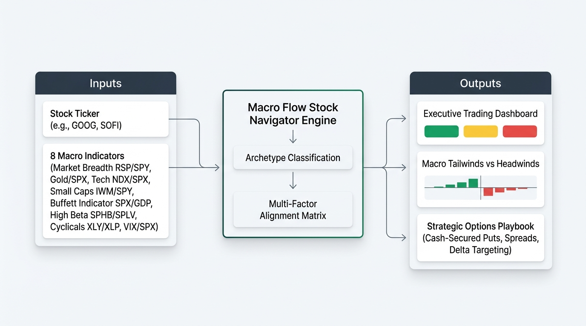
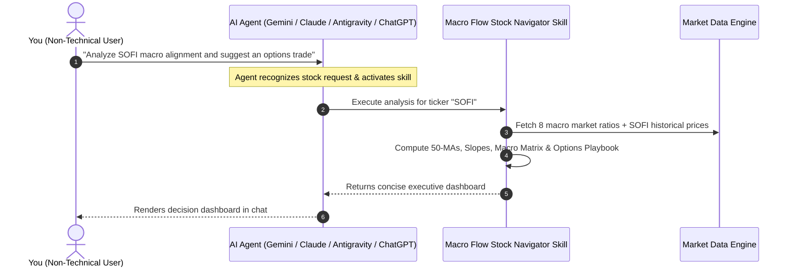

# Macro Flow Stock Navigator

**Version:** 1.0.0 | **Supported Harnesses:** Gemini Enterprise, Anthropic Claude, OpenAI ChatGPT, Antigravity | **License:** Apache 2.0 | **Tests:** 7 Passed | **Privacy:** 100% Synthetic / Zero PHI

**Macro Flow Stock Navigator** is an enterprise-grade agent skill and algorithmic decision engine designed for **Gemini Enterprise**, **Gemini Spark UI**, **Antigravity**, **Anthropic Claude (Desktop / Code / Agents)**, **ChatGPT / OpenAI Assistants**, and any AI agent harness complying with the `SKILL.md` and Skill Plug-in specifications.

It bridges high-level cross-asset macroeconomic regimes with single-stock positioning and quantitative derivative strategies. By calculating 8 real-time macro ratio indicators, determining stock archetypes, and running a weighted alignment matrix, the skill produces an executive, concise trading decision dashboard with clear status signals (`🟢 STRONG BUY`, `🟢 ACCUMULATE`, `🟡 NEUTRAL / RANGING`, `🔴 PROTECT / SELL`) and an actionable **Strategic Options Playbook** (Cash-Secured Puts, Covered Calls, Debit Spreads).



---

## Table of Contents
1. [Key Features & Capabilities](#key-features--capabilities)
2. [Non-Technical User Quickstart](#non-technical-user-quickstart)
3. [Sample Prompts Library](#sample-prompts-library)
4. [How to Read the Output (Executive Decoder)](#how-to-read-the-output-executive-decoder)
5. [Frequently Asked Questions (FAQ)](#frequently-asked-questions-faq)
6. [The 8 Macro Ratio Indicators](#the-8-macro-ratio-indicators)
7. [Stock Archetype Taxonomy](#stock-archetype-taxonomy)
8. [Strategic Options Playbook Matrix](#strategic-options-playbook-matrix)
9. [Running the Python Code (Technical Guide)](#running-the-python-code-technical-guide)
10. [Synthetic Data & Privacy Compliance](#synthetic-data--privacy-compliance)
11. [Automated Testing & Verification](#automated-testing--verification)
12. [Repository Structure](#repository-structure)
13. [License](#license)

---

## Key Features & Capabilities

- **Cross-Asset Macro Regime Detection:** Synthesizes 8 distinct market ratios spanning breadth, gold, tech momentum, small caps, market valuation, high beta, cyclical consumption, and volatility.
- **Stock Archetype Sensitivity Engine:** Dynamically classifies equities into 5 core archetypes (Mega-Cap Tech, High-Beta Speculative Growth, Cyclicals, Defensives, Financials) and applies tailored mathematical sensitivity weights.
- **Concise Executive Dashboard:** Delivers clean Markdown cards with summary status tables, status circle color indicators (`🟢`, `🟡`, `🔴`), force decomposition (tailwinds vs. headwinds), and options execution tables.
- **Quantitative Options Execution:** Formulates exact option parameters including Delta targeting (e.g. `0.20-0.28 Delta`), optimal strike placement (e.g. `% OTM below 50-MA support`), target DTE (`30-45 DTE`), and risk-defined stop-loss criteria.
- **Offline & Fallback Resilient:** Seamlessly falls back to pre-packaged synthetic datasets if live financial feeds are restricted or offline.

---

## Non-Technical User Quickstart

> **Good News:** You do **not** need to install Python, write code, or open a terminal to use this skill. When added to your agent workspace (Gemini, Claude, Antigravity, or ChatGPT), the AI handles all computations automatically.



### 3 Simple Steps to Use the Skill:
1. **Open your AI chat window** (Gemini Enterprise, Claude, Antigravity, or ChatGPT).
2. **Type a simple request with any US stock ticker symbol** (e.g., `GOOG`, `SOFI`, `NVDA`, `AAPL`, `TSLA`, `CAT`, `JNJ`, `JPM`).
3. **Receive your complete visual dashboard** with stock signals, macro indicators table, tailwinds/headwinds breakdown, and tactical options blueprint.

---

## Sample Prompts Library

Copy and paste any of the sample prompts below directly into your AI assistant:

### 1. Basic Stock & Macro Health Checks
| Goal | Copy-Paste Sample Prompt |
| :--- | :--- |
| **Single Stock Analysis** | *"Analyze Google (`GOOG`) using the Macro Flow Stock Navigator. Is the macro environment bullish or bearish for it today?"* |
| **Speculative Growth Check** | *"Is the current market flow favorable for `SOFI`? Check small-cap breadth and speculative appetite."* |
| **Mega-Cap Tech Leadership** | *"Run a macro flow check on `NVDA`. Is tech momentum still leading the market, or is money rotating into defensives?"* |
| **Plain-English Request** | *"Evaluate `AAPL` with the Macro Flow Stock Navigator and explain the results concisely in business terms."* |

### 2. Options Strategy & Income Generation
| Goal | Copy-Paste Sample Prompt |
| :--- | :--- |
| **Selling Cash-Secured Puts** | *"I want to generate income by selling cash-secured puts on `SOFI` or `PLTR`. Use the Macro Flow Stock Navigator to check if it's safe and tell me the optimal strike price and delta."* |
| **Selling Covered Calls** | *"I own 100 shares of `GOOG`. Run a macro alignment check and recommend a 30-day covered call strike above key resistance."* |
| **Low-Risk Growth Spreads** | *"What options strategy does the Macro Flow Navigator recommend for `NVDA` right now based on its implied volatility and macro score?"* |
| **Yield vs. Capital Safety** | *"Compare the risk-reward of selling puts on `TSLA` (high volatility) versus `CAT` (industrial cyclical) under current macro flow conditions."* |

### 3. Portfolio Protection & Risk Management
| Goal | Copy-Paste Sample Prompt |
| :--- | :--- |
| **Hedging Tech Holdings** | *"The market feels volatile. Run a macro flow check on my tech holdings (`MSFT`, `AAPL`) and suggest downside protection or bear spreads if needed."* |
| **Flight to Safety Check** | *"Is capital rotating into Gold (`GLD`) or Low Volatility (`SPLV`)? Run the Macro Flow Navigator for `JNJ` to see if defensive value is winning."* |
| **Pre-FOMC Risk Review** | *"Check the `VIX / SPX` and `IWM / SPY` ratios for `SOFI` ahead of the upcoming Fed interest rate announcement."* |

### 4. Multi-Stock & Sector Comparison
| Goal | Copy-Paste Sample Prompt |
| :--- | :--- |
| **Tech vs. Industrial** | *"Compare `GOOG` (Mega-Cap Tech) and `CAT` (Industrial Cyclical) with the Macro Flow Stock Navigator. Which one has stronger macro tailwinds this month?"* |
| **Growth vs. Defensive** | *"Should I allocate capital to `SOFI` (Speculative Growth) or `JNJ` (Defensive Value)? Run a cross-asset alignment comparison on both."* |

### 5. Offline & Advanced Agent Pipeline Prompts
| Goal | Copy-Paste Sample Prompt |
| :--- | :--- |
| **Offline Simulated Demo** | *"Run a demonstration of the Macro Flow Stock Navigator for `GOOG` in synthetic benchmark mode."* |
| **JSON Export for Downstream Tools** | *"Analyze `SOFI` using the Macro Flow Stock Navigator and output the raw structured JSON payload."* |

---

## How to Read the Output (Executive Decoder)

When the skill completes its analysis, it renders a clean, concise 4-part dashboard:

### 1. Executive Summary Table
```markdown
# Macro Flow Stock Navigator: GOOG

| Metric | Value | Metric | Value |
| :--- | :--- | :--- | :--- |
| **Current Price** | $267.73 (+2.12%) | **Stock Archetype** | Mega-Cap Tech / High Quality Growth |
| **Recommended Action** | 🟢 ACCUMULATE | **Macro Alignment** | [██████░░░░] +37.5/100 (🟢 Bullish) |
| **Macro Regime** | Consolidation / Sector Rotation | **Timestamp** | 2026-08-17 19:30 UTC |
```
- **`🟢 STRONG BUY / ACCUMULATE`**: Macro currents are strongly aligned in the stock's favor. Favorable for long positioning or selling cash-secured puts.
- **`🟡 NEUTRAL (RANGING)`**: Mixed macro signals. Stock is oscillating in a channel; optimal for theta harvesting (Covered Calls or Iron Condors).
- **`🔴 REDUCE / PROTECT / SELL`**: Hostile macro headwinds (rising fear, capital flight). Avoid unhedged long exposure.

### 2. Macro Cross-Asset Indicators (8 Ratios)
- **`RSP / SPY` (Market Breadth):** Equal-weight vs. cap-weight S&P 500 (broad participation vs. narrow concentration).
- **`GLD / SPX` (Risk Sentiment):** Gold vs. S&P 500 (falling = risk-on pro-growth; rising = safe-haven flight).
- **`NDX / SPX` (Tech Momentum):** Nasdaq 100 vs. S&P 500 (tech leadership & multiple expansion).
- **`IWM / SPY` (Small-Cap Vitality):** Russell 2000 vs. S&P 500 (economic liquidity and credit sentiment).
- **`SPX / GDP` (Valuation):** S&P to GDP Buffett indicator (valuation multiple expansion vs. mean reversion).
- **`SPHB / SPLV` (Speculative Appetite):** High Beta vs. Low Volatility (risk tolerance vs. defensiveness).
- **`XLY / XLP` (Cyclical Health):** Discretionary vs. Staples (consumer confidence vs. belt-tightening).
- **`VIX / SPX` (Normalized Fear):** Volatility index normalized against broad index trend.

### 3. Macro Drivers & Sensitivity Analysis
- **🟢 Tailwinds:** Macro forces actively supporting upward momentum.
- **🔴 Headwinds:** Macro resistances that could compress valuations or trigger pullbacks.

### 4. Strategic Options Playbook
- **Strategy Selection:** Formulated based on historical volatility and macro alignment.
- **Target Delta:** Calibrated for statistical probability of profit (e.g., `0.20-0.28 Delta` = ~75-80% probability).
- **Strike Selection:** Positioned safely below key 50-day moving average support floors.
- **Target DTE:** 30 to 45 days to optimize theta time decay.
- **Risk Management:** Clear, defined-risk exit rules for profit targets and stop losses.

---

## Frequently Asked Questions (FAQ)

### Q1: Do I need any API keys or paid financial subscriptions?
**No.** The skill automatically fetches free public market data and includes a built-in offline simulation mode.

### Q2: What stock ticker symbols work?
**Any publicly traded US equity or ETF.** Examples: `GOOG`, `AAPL`, `MSFT`, `NVDA`, `SOFI`, `PLTR`, `TSLA`, `CAT`, `JNJ`, `JPM`, `SPY`, `QQQ`, `IWM`.

### Q3: Does this skill store any of my personal or financial information?
**No.** The skill contains **zero Protected Health Information (PHI) and zero Personally Identifiable Information (PII)**. It only processes the public ticker symbol you provide.

---

## The 8 Macro Ratio Indicators

| Indicator | Ratio Tickers | What It Measures | Favorable Condition |
| :--- | :--- | :--- | :--- |
| **Market Breadth** | `RSP / SPY` | Equal-weight vs. cap-weight S&P 500 | Rising = Broad market participation; Falling = Narrow mega-cap dominance |
| **Macro Risk Sentiment** | `GLD / SPX` | Gold vs. S&P 500 Index | Falling = Pro-growth Risk-On; Rising = Flight-to-safety / stagflation hedge |
| **Tech Momentum** | `NDX / SPX` | Nasdaq 100 vs. S&P 500 | Rising = Tech leadership & growth multiple expansion; Falling = Value rotation |
| **Small Cap Strength** | `IWM / SPY` | Russell 2000 vs. S&P 500 | Rising = Economic expansion & liquidity; Falling = Tightening / large-cap flight |
| **Macro Valuation** | `SPX / GDP` | Buffett Indicator (Market Cap to GDP) | Normalized = Healthy equity valuations (<140%) |
| **Speculative Appetite** | `SPHB / SPLV` | High Beta vs. Low Volatility S&P | Rising = Speculative risk-seeking; Falling = Capital preservation |
| **Cyclical Growth** | `XLY / XLP` | Consumer Discretionary vs. Staples | Rising = Strong consumer spending confidence; Falling = Defensive belt-tightening |
| **Fear Normalization** | `VIX / SPX` | Normalized CBOE Volatility Index | Falling = Volatility compression; Spiking = Capitulation or stress |

*For detailed formulas and historical regimes, see [`references/macro_indicators_guide.md`](references/macro_indicators_guide.md).*

---

## Stock Archetype Taxonomy

```
                          ┌──────────────────────────┐
                          │   Target Stock Ticker    │
                          └─────────────┬────────────┘
                                        │
             ┌──────────────────────────┼──────────────────────────┐
             ▼                          ▼                          ▼
   ┌───────────────────┐      ┌───────────────────┐      ┌───────────────────┐
   │   MEGA-CAP TECH   │      │ HIGH-BETA GROWTH  │      │CYCLICAL/INDUSTRIAL│
   │  GOOG, MSFT, AAPL │      │ SOFI, PLTR, AFRM  │      │  CAT, DE, GM, URI │
   │ Sensitive to NDX, │      │ Sensitive to IWM, │      │ Sensitive to XLY, │
   │ RSP concentration │      │ SPHB, GLD, & VIX  │      │ RSP, & IWM breadth│
   └───────────────────┘      └───────────────────┘      └───────────────────┘
             │                                                     │
             └──────────────────────────┬──────────────────────────┘
                                        │
             ┌──────────────────────────┴──────────────────────────┐
             ▼                                                     ▼
   ┌───────────────────┐                                 ┌───────────────────┐
   │  DEFENSIVE VALUE  │                                 │FINANCIALS/BANKING │
   │  JNJ, PG, KO, WMT │                                 │ JPM, BAC, GS, MS  │
   │ Sensitive to SPLV,│                                 │ Sensitive to IWM, │
   │ GLD, low beta     │                                 │ RSP, credit yield │
   └───────────────────┘                                 └───────────────────┘
```

*For complete archetype sensitivity weights, see [`references/archetype_taxonomy.md`](references/archetype_taxonomy.md).*

---

## Strategic Options Playbook Matrix

| Macro Alignment | Realized Volatility | Technical Structure | Recommended Options Play |
| :--- | :--- | :--- | :--- |
| **Bullish (> +20)** | **High (IV > 35%)** | Above 50-MA or Support | **Cash-Secured Puts (0.20-0.28 Delta, 30-45 DTE)** |
| **Bullish (> +20)** | **Low (IV < 30%)** | Clean Breakout | **Bull Call Debit Spread (ATM/OTM, 45-75 DTE)** |
| **Neutral (-15 to +20)** | **High (IV > 35%)** | Range-Bound Channel | **Iron Condor / Short Put Spreads** |
| **Neutral (-15 to +20)** | **Moderate (IV 20-35%)** | Mild Uptrend | **Covered Calls (0.25-0.35 Delta, 21-35 DTE)** |
| **Bearish (< -20)** | **Elevated** | Below 50-MA Breakdown | **Bear Put Spread / Downside Collar** |

*For complete strike selection rules, see [`references/options_playbook_matrix.md`](references/options_playbook_matrix.md).*

---

## Running the Python Code (Technical Guide)

### 1. Installation & Environment Setup
```bash
# Navigate to the skill directory
cd macro-flow-stock-navigator-skill

# Create and activate virtual environment
python3 -m venv .venv
source .venv/bin/activate

# Install dependencies
pip install -r requirements.txt
```

### 2. Command-Line Interface (CLI) Usage
The main runner is located at [`scripts/run_analysis.py`](scripts/run_analysis.py):

```bash
# Analyze a Mega-Cap Tech stock (e.g. GOOG)
python3 scripts/run_analysis.py --ticker GOOG

# Analyze a High-Beta Speculative stock (e.g. SOFI)
python3 scripts/run_analysis.py --ticker SOFI

# Run in offline synthetic benchmark mode (no internet required)
python3 scripts/run_analysis.py --ticker NVDA --mode synthetic

# Generate structured JSON output for API/agent pipelines
python3 scripts/run_analysis.py --ticker SOFI --format json

# Save dashboard report to a markdown file
python3 scripts/run_analysis.py --ticker GOOG --output reports/GOOG_report.md
```

### CLI Parameter Options:
- `--ticker`, `-t`: Target ticker symbol (default: `GOOG`).
- `--lookback`, `-l`: Lookback window in trading days (default: `90`).
- `--mode`, `-m`: Data retrieval mode: `auto` (default), `live`, or `synthetic`.
- `--format`, `-f`: Output format: `spark` (default markdown dashboard), `json`, or `summary`.
- `--output`, `-o`: File path to save output.
- `--gdp`: Nominal US GDP in Trillions for the Buffett indicator calculation (default: `29.5`).

---

## Synthetic Data & Privacy Compliance

- The repository includes a pre-generated synthetic dataset at [`sample_data/synthetic_market_data.json`](sample_data/synthetic_market_data.json).
- **100% Synthetic Data:** All benchmark series and prices in `sample_data/` are mathematically generated using geometric Brownian motion and correlated stochastic processes.
- **Zero Protected Health Information (PHI) & Zero Sensitive PII:** Safe for deployment across air-gapped, enterprise, and developer environments.
- To re-generate custom synthetic datasets:
  ```bash
  python3 scripts/generate_synthetic_data.py --days 150 --seed 42
  ```

---

## Automated Testing & Verification

The codebase includes full unit and integration test coverage across all mathematical models, data fetchers, and rendering engines.

```bash
# Run the complete test suite
python3 scripts/test_skill.py

# Or run pytest directly
pytest -v tests/
```

---

## Repository Structure

```text
macro-flow-stock-navigator-skill/
├── LICENSE                           # Apache License 2.0
├── SKILL.md                          # Primary Agent Skill specification for Gemini & Antigravity
├── plugin.json                       # Skill Plug-in manifest
├── README.md                         # Comprehensive documentation and non-technical guide
├── requirements.txt                  # Python dependencies
├── pyproject.toml                    # Package metadata
├── docs/
│   └── images/
│       └── macro_flow_workflow.jpg   # Architecture & workflow diagram
├── scripts/
│   ├── run_analysis.py               # Main CLI tool for market analysis & dashboard rendering
│   ├── generate_synthetic_data.py    # Synthetic market data generator (zero PHI)
│   └── test_skill.py                 # Automated verification & test suite
├── src/
│   ├── __init__.py
│   ├── config.py                     # Stock archetypes, indicator weights, and options rules
│   ├── data_fetcher.py               # Live (yfinance) & synthetic data fetcher with fallback
│   ├── indicators.py                 # Mathematical engine for 8 macro ratios
│   ├── decision_engine.py            # Alignment scoring & options playbook recommender
│   └── renderer.py                   # Executive dashboard & JSON formatters
├── sample_data/
│   ├── synthetic_market_data.json    # Pre-computed synthetic multi-asset dataset
│   ├── sample_output_GOOG.md         # Example rendered dashboard for GOOG
│   ├── sample_output_SOFI.md         # Example rendered dashboard for SOFI
│   └── sample_output_NVDA.md         # Example rendered dashboard for NVDA
├── references/
│   ├── macro_indicators_guide.md     # Deep dive into the 8 macro ratio indicators
│   ├── options_playbook_matrix.md    # Options strategy selection & execution matrix
│   └── archetype_taxonomy.md         # Stock archetype classification & sensitivity rules
└── tests/
    ├── __init__.py
    ├── test_indicators.py            # Unit tests for indicator math
    ├── test_decision_engine.py       # Unit tests for decision logic & archetypes
    └── test_end_to_end.py            # End-to-end integration tests
```

---

## License

This project is licensed under the terms of the Apache License 2.0. See the [LICENSE](LICENSE) file for details.
