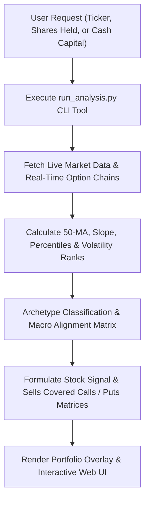

# Macro Flow Stock Navigator

An enterprise-grade cross-asset decision engine for AI agent harnesses. It bridges macroeconomic regime dynamics with single-stock positioning and tactical options execution (Selling Covered Calls & Cash-Secured Puts) using real-time market data.

---

## When to Use This Skill

Activate this skill when the user:
- Asks for a **macro health check** or **relative strength analysis** for any stock ticker (e.g., "Analyze GOOG macro flow alignment", "Is SOFI in a favorable macro environment?").
- Asks for **personalized Covered Call recommendations** given a number of shares held (e.g., "I own 300 shares of GOOG, what covered call should I sell?").
- Asks for **personalized Cash-Secured Put recommendations** given a cash dollar amount (e.g., "I have $25,000 cash, what cash-secured puts should I sell on SOFI?").
- Requests an **options selling playbook** evaluating implied volatility rank, IV vs. RV spread, Put/Call volume & open interest ratio, Max Pain strike, and institutional Unusual Option Activity (UOA).
- Inquires about the **8 cross-asset macro indicators** (RSP/SPY, GLD/SPX, NDX/SPX, IWM/SPY, SPX/GDP, SPHB/SPLV, XLY/XLP, VIX/SPX).

---

## Execution Workflow for Agents

When this skill is invoked with a user's stock ticker (e.g., `GOOG`, `SOFI`, `NVDA`, `AAPL`) and optional portfolio parameters (`--shares`, `--cash`):



### Step 1: Run the Core Python Tool
Execute the analysis script located at [`scripts/run_analysis.py`](scripts/run_analysis.py):

```bash
# Standard real-time execution (outputs Markdown dashboard)
python3 scripts/run_analysis.py --ticker <TICKER> --format markdown

# With shares held for tailored Covered Call recommendation:
python3 scripts/run_analysis.py --ticker <TICKER> --shares <NUM_SHARES>

# With cash amount for tailored Cash-Secured Put recommendation:
python3 scripts/run_analysis.py --ticker <TICKER> --cash <DOLLAR_AMOUNT>

# Combined portfolio analysis with shares held and available cash:
python3 scripts/run_analysis.py --ticker <TICKER> --shares 200 --cash 35000

# Generate interactive Web UI HTML Dashboard (renders in UI iframe):
python3 scripts/run_analysis.py --ticker <TICKER> --format html --output reports/dashboard_<TICKER>.html

# For programmatic downstream agent JSON consumption:
python3 scripts/run_analysis.py --ticker <TICKER> --format json
```

### Step 2: Extract & Verify Output
1. The script automatically fetches real-time historical time series for the 8 macro ratio pairs and the target equity's live option chain.
2. It computes the 50-day moving average, trend slope, and 90-day percentile rank for each macro indicator.
3. It screens three distinct risk tiers (Conservative 0.20Δ, Balanced 0.30Δ, Aggressive 0.40Δ) for both **Covered Calls** and **Cash-Secured Puts**.
4. If `--shares` or `--cash` is supplied, it generates an immediate **Portfolio Positioning & Tailored Options Recommendation** section detailing exact contract capacity, upfront premium income, annualized yield/ROC, break-even cost basis, and assigned return.
5. It detects institutional **Unusual Option Activity (UOA)** where volume exceeds 1.5x Open Interest.

### Step 3: Present the Executive Dashboard & Answer Follow-Up Questions
Deliver the formatted Markdown or interactive Web UI dashboard directly to the user:
1. **Executive Summary & Tailored Portfolio Section:** Displays exact shares held / cash deployed, contract capacity, and projected income.
2. **8 Macro Cross-Asset Indicators Table:** RSP/SPY, GLD/SPX, NDX/SPX, IWM/SPY, SPX/GDP, SPHB/SPLV, XLY/XLP, VIX/SPX with moving average trends.
3. **Covered Call & Cash-Secured Put Screener Matrices:** Conservative, Balanced, and Aggressive tiers with strike, premium mid, delta, theta, OTM %, yield, cushion, and net basis.
4. **Institutional Option Flow & Max Pain:** Key market sentiment indicators, IV rank, Put/Call ratios, and anomalous sweeps.
5. **Answering Subsequent Options Questions:**
   - If the user asks *"What if I have X shares?"* or *"What if I have $Y cash?"*, use the screener matrices to immediately calculate exact contracts (`shares // 100` or `cash // (strike * 100)`), upfront premium cashflow, downside protection buffer, and optimal rollover rules.

---

## The 8 Core Macro Ratio Indicators

| Indicator | Ratio Tickers | What It Measures | Favorable Condition |
| :--- | :--- | :--- | :--- |
| **Market Breadth** | `RSP / SPY` | Equal-weight vs. cap-weight S&P 500 | Rising = Broad market participation; Falling = Narrow mega-cap dominance |
| **Macro Risk Sentiment** | `GLD / SPX` | Gold vs. S&P 500 Index | Falling = Pro-growth Risk-On; Rising = Flight-to-safety / stagflation hedge |
| **Tech Momentum** | `NDX / SPX` | Nasdaq 100 vs. S&P 500 | Rising = Tech leadership & growth multiple expansion; Falling = Value rotation |
| **Small Cap Strength** | `IWM / SPY` | Russell 2000 vs. S&P 500 | Rising = Economic expansion & liquidity; Falling = Tightening / large-cap flight |
| **Macro Valuation** | `SPX / GDP` | Buffett Indicator (Market Cap to GDP) | Normalized = Healthy equity valuations (<140%) |
| **Speculative Appetite** | `SPHB / SPLV` | High Beta vs. Low Volatility S&P | Rising = Speculative risk-seeking; Falling = Capital preservation |
| **Cyclical Growth** | `XLY / XLP` | Consumer Discretionary vs. Staples | Rising = Strong consumer spending confidence; Falling = Defensive belt-tightening |
| **Fear Normalization** | `VIX / SPX` | Normalized CBOE Volatility Index | Falling = Volatility compression; Spiking = Capitulation or stress |

*For detailed explanations, refer to [`references/macro_indicators_guide.md`](references/macro_indicators_guide.md).*

---

## Options Selling Rules & Sizing Framework

- **Covered Calls (Long 100 Shares + Sell Call):**
  - **Contract Capacity:** `floor(shares_held / 100)`.
  - **Conservative Tier (0.20Δ):** ~80% probability of expiring unassigned; maximizes share retention.
  - **Balanced Tier (0.30Δ):** Optimal balance between upfront income and upside stock appreciation.
  - **Aggressive Tier (0.40Δ):** Highest cashflow yield; best for neutral or hostile macro regimes.
- **Cash-Secured Puts (Cash Collateral + Sell Put):**
  - **Contract Capacity:** `floor(cash_available / (strike * 100))`.
  - **Conservative Tier (0.20Δ):** Deep discount (~80% win rate); safe entry into high-quality growth stocks.
  - **Balanced Tier (0.30Δ):** High annualized Return on Capital (ROC) anchored below moving average support.
  - **Aggressive Tier (0.40Δ):** Maximizes cash premium harvest in high-IV regimes.

---

## Testing & Verification

To verify the skill's integrity and execute the automated test suite:

```bash
# Run the complete test suite (unit tests + real-time live verification)
python3 scripts/test_skill.py
```
