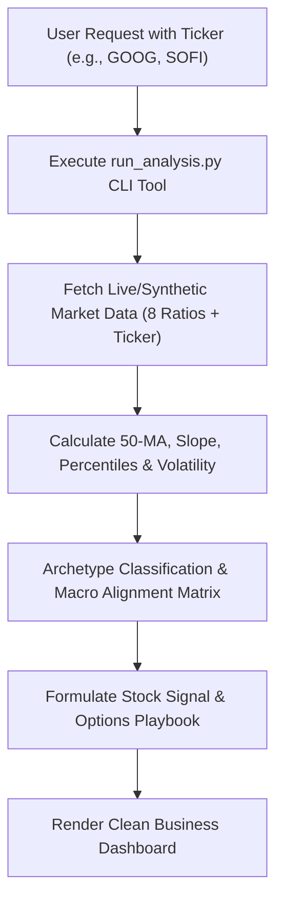

# Macro Flow Stock Navigator

An enterprise-grade cross-asset decision engine for Gemini Enterprise, Anthropic Claude, OpenAI ChatGPT, Antigravity, and AI agent harnesses. It bridges macroeconomic regime dynamics with single-stock positioning and tactical options execution.

---

## When to Use This Skill

Activate this skill when the user:
- Asks for a **macro health check** or **relative strength analysis** for any stock ticker (e.g., "Analyze GOOG macro flow alignment", "Is SOFI in a favorable macro environment?").
- Requests an **options strategy recommendation** (e.g., "Should I sell cash-secured puts or covered calls on SOFI?", "What delta and strike should I trade on GOOG?").
- Asks for a **trading decision dashboard** evaluating market breadth, risk-on vs. risk-off sentiment, tech momentum, and volatility.
- Inquires about the **8 cross-asset macro indicators** (RSP/SPY, GLD/SPX, NDX/SPX, IWM/SPY, SPX/GDP, SPHB/SPLV, XLY/XLP, VIX/SPX).

---

## Execution Workflow for Agents

When this skill is invoked with a user's stock ticker (e.g., `GOOG`, `SOFI`, `NVDA`, `AAPL`):



### Step 1: Run the Core Python Tool
Execute the analysis script located at [`scripts/run_analysis.py`](scripts/run_analysis.py) using the user's ticker symbol:

```bash
# Standard execution (auto-fetches live data or falls back to synthetic)
python3 scripts/run_analysis.py --ticker <TICKER> --format spark

# For programmatic downstream agent JSON consumption:
python3 scripts/run_analysis.py --ticker <TICKER> --format json

# For purely offline / synthetic benchmark mode:
python3 scripts/run_analysis.py --ticker <TICKER> --mode synthetic
```

### Step 2: Extract & Verify Output
1. The script automatically fetches the required 120-day historical time series for the 8 macro ratio pairs and the target equity.
2. It computes the 50-day moving average, trend slope, and 90-day percentile rank for each indicator.
3. It determines the **Archetype Sensitivity Alignment** and calculates the **Macro Alignment Score** (-100 to +100).
4. It derives the **Recommended Action Signal** (e.g., `🟢 STRONG BUY`, `🟢 ACCUMULATE`, `🟡 NEUTRAL (RANGING)`, `🔴 PROTECT / SELL`).
5. It computes the exact **Options Playbook** (target strategy, recommended delta, exact strike price offset below support, DTE, and risk warnings).

### Step 3: Present the Executive Dashboard
Deliver the formatted Markdown directly to the user. Maintain the concise visual hierarchy:
1. **Header & Summary Table:** Ticker, price, action badge (`🟢`, `🟡`, `🔴`), alignment gauge, and macro regime.
2. **Macro Cross-Asset Indicators Table:** 8 macro ratios with ratio tickers, current value, 50-MA status, trend signal, and market meaning.
3. **Macro Drivers & Sensitivity Analysis:** Technical health metrics and concise list of `🟢 Tailwinds` vs. `🔴 Headwinds`.
4. **Strategic Options Playbook:** Clean table with Strategy, Delta, Strike, DTE, Yield, Profit Target, and Stop Loss.
5. **Key Risk Considerations:** Specific macro contradictions and risk factors.

---

## The 8 Core Macro Ratio Indicators

| Indicator | Ratio Tickers | What It Measures | Favorable Condition |
| :--- | :--- | :--- | :--- |
| **Market Breadth** | `RSP / SPY` | Equal-weight vs. cap-weight S&P 500 | Rising = Broad market participation; Falling = Narrow mega-cap dominance |
| **Macro Risk Sentiment** | `GLD / SPX` | Gold vs. S&P 500 Index | Falling = Pro-growth Risk-On; Rising = Flight-to-safety / stagflation hedge |
| **Tech Momentum** | `NDX / SPX` | Nasdaq 100 vs. S&P 500 | Rising = Tech leadership & growth multiple expansion; Falling = Value rotation |
| **Small Cap Strength** | `IWM / SPY` | Russell 2000 vs. S&P 500 | Rising = Economic expansion & liquidity; Falling = Tightening / large-cap flight |
| **Macro Valuation** | `SPX / GDP` | Buffett Indicator (Market Cap to GDP) | Normalized = Healthy equity valuations (<140%) |
| **Speculative Appetite** | `SPHB / SPLV` | High Beta vs. Low Volatility S&P | Rising = Speculative risk-seeking; Falling = Capital preservation |
| **Cyclical Growth** | `XLY / XLP` | Consumer Discretionary vs. Staples | Rising = Strong consumer spending confidence; Falling = Defensive belt-tightening |
| **Fear Normalization** | `VIX / SPX` | Normalized CBOE Volatility Index | Falling = Volatility compression; Spiking = Capitulation or stress |

*For detailed explanations, refer to [`references/macro_indicators_guide.md`](references/macro_indicators_guide.md).*

---

## Stock Archetypes & Alignment Logic

The decision engine routes the target ticker into 5 distinct behavioral archetypes:

1. **Mega-Cap Tech (`MEGA_CAP_TECH`):** (e.g., `GOOG`, `MSFT`, `AAPL`, `NVDA`, `META`, `AMZN`)
   - *Tailwinds:* Rising `NDX/SPX`, falling `RSP/SPY` (when mega-caps lead), falling `GLD/SPX`.
   - *Headwinds:* Severe spikes in `VIX/SPX`, rotation out of tech into defensives.
2. **High-Beta Speculative Growth (`HIGH_BETA_GROWTH`):** (e.g., `SOFI`, `PLTR`, `ROKU`, `AFRM`, `COIN`)
   - *Tailwinds:* Rising `IWM/SPY`, rising `SPHB/SPLV`, falling `GLD/SPX`, compressing `VIX/SPX`.
   - *Headwinds:* Rising gold/safe-haven demand, small-cap lag, tight liquidity.
3. **Cyclical & Industrial (`CYCLICAL_INDUSTRIAL`):** (e.g., `CAT`, `DE`, `GM`, `NKE`, `URI`, `XOM`)
   - *Tailwinds:* Rising `XLY/XLP`, rising `RSP/SPY`, rising `IWM/SPY`.
4. **Defensive & Value (`DEFENSIVE_VALUE`):** (e.g., `JNJ`, `PG`, `KO`, `PEP`, `MCD`, `WMT`)
   - *Tailwinds:* Falling `SPHB/SPLV` (Low Vol leading), rising `GLD/SPX`, tech de-risking.
5. **Financials & Banking (`FINANCIAL_BANKING`):** (e.g., `JPM`, `BAC`, `GS`, `MS`, `WFC`)
   - *Tailwinds:* Broad market expansion, domestic credit growth (`IWM/SPY`), consumer health.

*For full taxonomy details, refer to [`references/archetype_taxonomy.md`](references/archetype_taxonomy.md).*

---

## Options Playbook Strategy Matrix

- **High Volatility (IV > 35%) + Bullish/Neutral Macro:**
  - **Strategy:** `Cash-Secured Puts (CSP)` or `Bull Put Spread`
  - **Delta:** `0.20 - 0.28 Delta` (~75-80% PoP)
  - **Strike:** 7% - 12% OTM, anchored below the 50-day Moving Average support.
  - **DTE:** `30 - 45 DTE` (captures accelerated theta decay).
- **Low Volatility (IV < 30%) + Bullish Macro:**
  - **Strategy:** `Bull Call Debit Spread` (Buy 0.65 Delta, Sell 0.30 Delta, 45-75 DTE).
- **Neutral / Ranging Macro:**
  - **Strategy:** `Covered Calls` (0.25-0.35 Delta, 21-35 DTE) or `Iron Condors`.
- **Hostile / Risk-Off Macro:**
  - **Strategy:** `Bear Put Debit Spread` or `Collar / Protective Puts`.

*For complete trade management and stop loss rules, refer to [`references/options_playbook_matrix.md`](references/options_playbook_matrix.md).*

---

## Testing & Verification

To verify the skill's integrity and execute the automated test suite:

```bash
# Run the complete test suite (unit tests + synthetic verification)
python3 scripts/test_skill.py

# Re-generate clean synthetic datasets (100% synthetic, zero PHI/sensitive data)
python3 scripts/generate_synthetic_data.py --days 150
```
